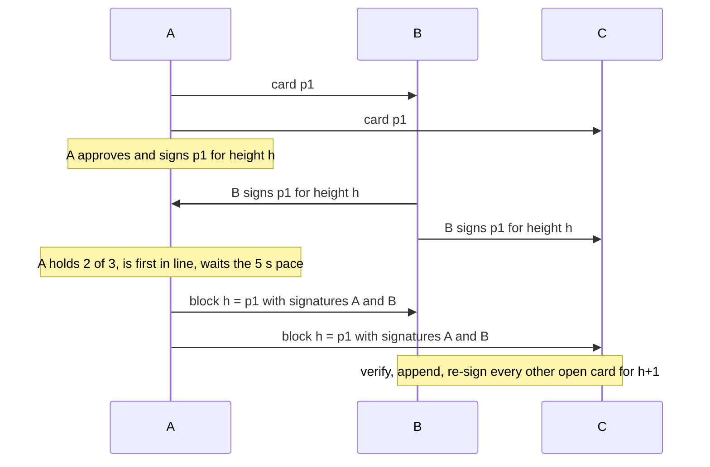
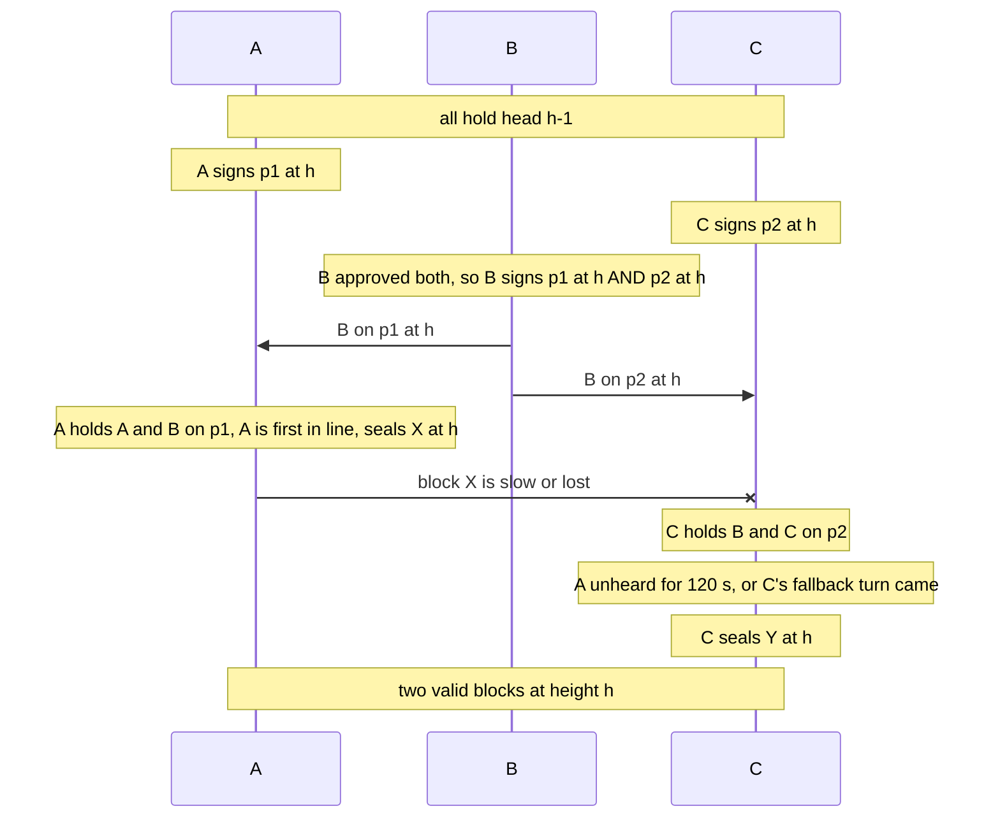
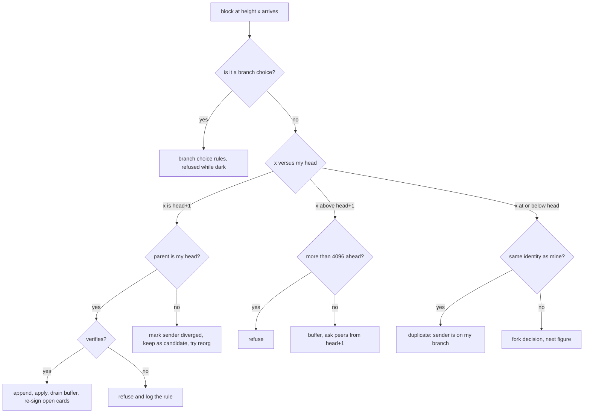
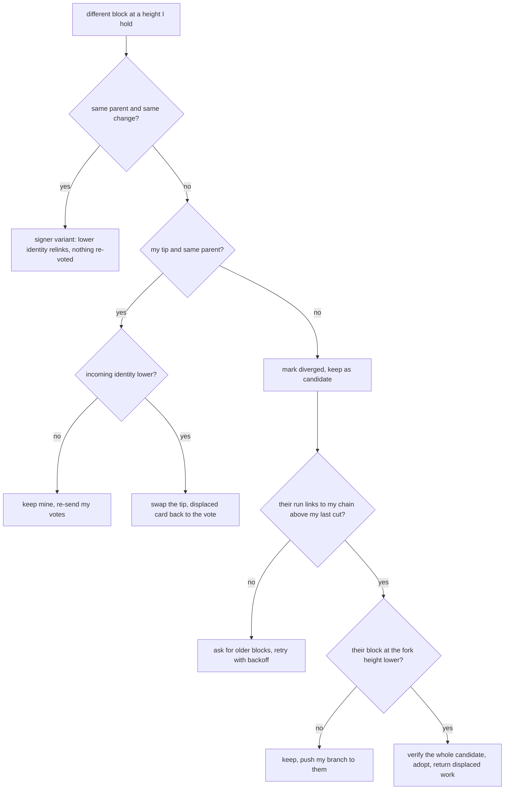
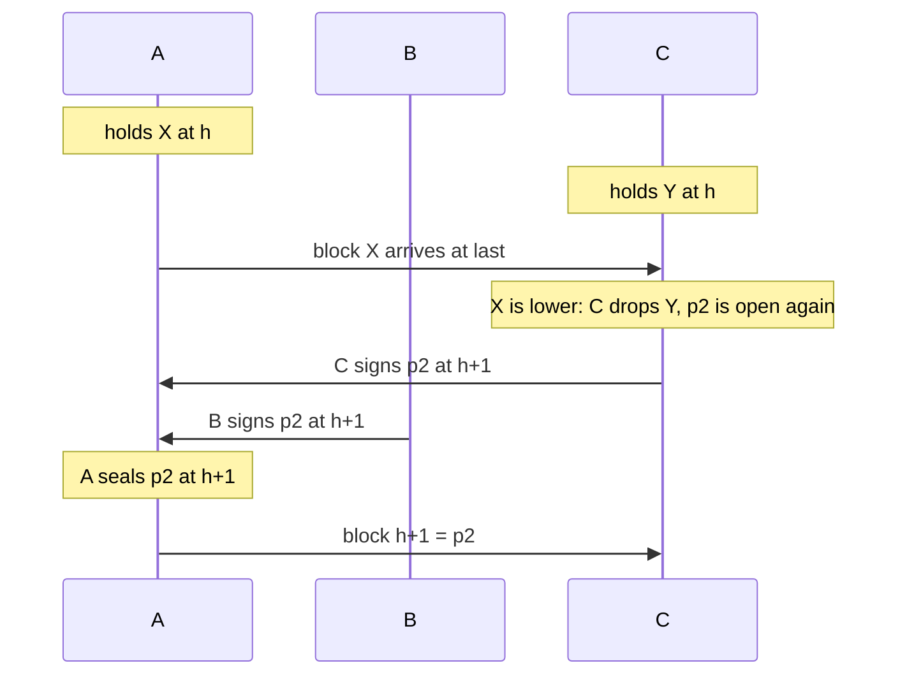
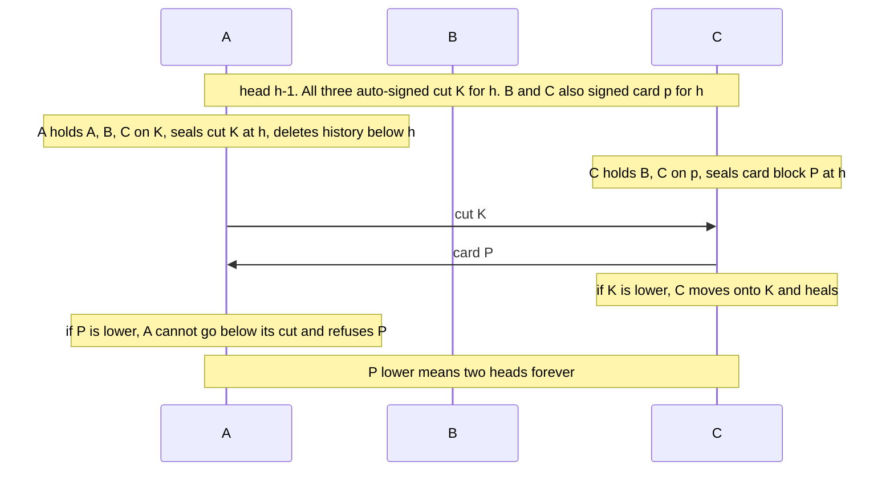

# The chain: how it agrees, why honest seats split

**Status: ANALYSIS for discussion, 2026-11-28; describes master 2239e162.
§13.6 corrected the same day (§13.7).**

Every claim carries one tag: **[VERIFIED in code]** (read in the source on
that commit, see Appendix A), **[FROM SPEC]** (a document says so, code not
checked), **[INFERRED]** (my deduction from verified rules). Examples use
invented seats A, B, C. Field numbers are counts from the plans in
`docs/`.

## 0. The answer in one paragraph

A seat's "yes" to a card is a signature for **the next free height**, and
a seat signs **every** card it said yes to for that same height. Nothing
says "one block per height". So with two open cards and one shared
supporter, two different groups of m signatures for the same height
exist on the network at the same time. Which one becomes a block is
decided by **who collects first and believes it is its turn**, and "its
turn" is judged by local clocks and by "whom did I hear in the last 120
seconds". Over Tor and slow relays two seats judge that differently, and
both seal. Afterwards a fixed rule (the smaller block fingerprint wins)
picks one branch, and the decisions on the other branch go back to the
vote. That is a fork. It becomes a **lasting split** when the two sides
cannot exchange or cannot judge each other's blocks.

## 1. Glossary

| term | meaning here |
|---|---|
| seat | one member of the republic, with its own signing key. Seats are fixed at founding |
| threshold m of n | n seats; an ordinary block needs m valid seat signatures |
| card | an open proposal waiting for signatures |
| block | one sealed decision: height, parent fingerprint, the change, m signatures |
| height | the block's position, 0 = founding, no gaps |
| head | the newest block a seat holds |
| identity | a block's fingerprint (a hash); the next block names it as its parent |
| seal | bundle m signatures into a block and send it |
| cut | a checkpoint block: every seat agrees on a summary of state; history below it is deleted |
| fork | two different valid blocks at one height |
| split | a fork that does not heal by itself |

## 2. How the chain is built

- One line of blocks. Block 0 is the founding, signed by all n. Every
  later block carries m signatures [VERIFIED in code].
- A signature covers: the republic, the **height**, and the change. From
  the "block-v2" activation on it also covers the **parent's identity**
  [VERIFIED in code]. It never covers who else signed.
- Below the activation a block's identity includes the signer list, so
  one decision sealed by two different signer pairs has two identities.
  From the activation the identity is height + parent + change only
  [VERIFIED in code].
- A receiver checks everything and rejects the whole chain on any fault:
  height gap, wrong parent, fewer than m valid distinct signers, a
  proposal applied twice, a cut whose summary does not match its own
  recomputation [VERIFIED in code]. This part is small and sound.
- The threshold m comes from the founding and never changes; adding seats
  is refused by the verifier [VERIFIED in code].
- Block kinds: founding, applied card, restore of a seat, three cut
  variants, branch choice [VERIFIED in code].

## 3. The normal path of one change

| step | rule | basis |
|---|---|---|
| propose | the card is gossiped; nobody signs a position yet | [VERIFIED in code] |
| approve | the seat records its stance and signs the card **for head+1** | [VERIFIED in code] |
| one card or many | no limit: a seat signs every card it approved, all for the same height | [VERIFIED in code] |
| head moves | every standing approval is signed again for the new head+1, automatically | [VERIFIED in code] |
| collect | per card, one signature per seat; a signature for an older height is dropped; for head+2 it is parked | [VERIFIED in code] |
| decline | a current decliner's signature is not counted by this seat | [VERIFIED in code] |
| enough signatures | m for a card, n for a cut, m-1 plus the returning seat's consent for a restore | [VERIFIED in code] |
| which signers | the m lowest-named valid ones | [VERIFIED in code] |
| who seals | the "sealing line": all roster seats heard within 120 s and not marked diverged, sorted by name. Rank 0 seals at once; rank k waits k x 60 s, then asks peers for a missed block, then seals 30 s later | [VERIFIED in code] |
| pace | over Nostr no seat seals within 5 s of its head moving | [VERIFIED in code] |
| which card | at its turn a seat seals the smallest open id it holds m signatures for | [VERIFIED in code] |
| broadcast | only after the block is on disk | [VERIFIED in code] |

Note: the plan's "as built" text says the line holds only seats that
signed the card; the code takes every heard seat [VERIFIED in code].

## 4. Why honest seats fork: the smallest example

Three seats, threshold 2. A proposes p1, C proposes p2. B likes both.

Nobody cheated. Each block has two honest signatures over exactly what
its signers approved. The protocol simply never asked B to pick one card
for height h [VERIFIED in code]. The only thing that is supposed to stop
C is the turn order, and that rests on time and on what C has heard
[VERIFIED in code]. On a local relay this never fires (milliseconds); on
Tor with relay gaps it fires often [FROM SPEC]: 79 forked heights in ~124
blocks in one day before the sealing line existed, 29 forked heights in
two days on v0.1.3 [FROM SPEC].

## 5. Every way honest seats get two blocks at one height

| # | minimal scenario (2 of 3) | why the rules allow it | basis |
|---|---|---|---|
| F1 | presence disagrees: C has not heard A for 120 s, A hears C. Both think they are first in line; B signed both cards | the line is built from local presence | [VERIFIED in code] |
| F2 | late block: A seals X; X reaches B and C later than their fallback turn (60 s + 30 s for B); B seals p2 | the fallback is a timer, not an agreement | [VERIFIED in code] |
| F3 | partition: in a 2 of 5 republic, A+B and C+D+E each reach 2 | allowed where 2m <= n; new foundings refuse it, old ones keep it | [FROM SPEC] |
| F4 | two restores of seat B: A and C each run a restore link; each has itself + B's consent = 2 | consent counts as one voice; m-1 survivors suffice | [VERIFIED in code] |
| F5 | old and new device: C + consent of B's new device restore B at h, while A + B's old device seal a card at h | nothing ties a signature to a device | [FROM SPEC] |
| F6 | cut and card: every seat auto-signs the cut at h and also its standing card at h; one sealer seals the cut (needs 3), another the card (needs 2) | the cut co-sign is automatic and sits beside the card signatures | [VERIFIED in code] |
| F7 | same decision, different signers, below block-v2: A seals p1 with A+B, C seals p1 with B+C | identity included the signer list | [VERIFIED in code] (fake fork, healed by relink) |

F1 and F2 are the field mechanism; F4 is the shape of the worst incident
(three seats on three branches) [FROM SPEC].

## 6. What a seat does with an incoming block

| situation | rule | outcome | basis |
|---|---|---|---|
| next height, my parent, valid | append | head moves, buffered blocks drain, standing cards re-sign at the new head+1 | [VERIFIED in code] |
| next height, my parent, invalid | refuse | logged with a rule code, kept in status | [VERIFIED in code] |
| next height, other parent | fork | sender marked diverged; block stored as candidate; reorg attempted | [VERIFIED in code] |
| an old block from a branch the sender has since left | drop | silently, by the sender's newer frames | [VERIFIED in code] |
| above head+1 | gap | buffered up to 4096 ahead, catch-up asked | [VERIFIED in code] |
| at or below head, same identity | duplicate | clears a divergence mark at or above the fork height | [VERIFIED in code] |
| at or below head, different | fork decision (§7) | | [VERIFIED in code] |
| no head yet | only a matching founding is taken, the rest buffered | | [VERIFIED in code] |

## 7. The fork decision: tie-break and reorg

| rule | content | basis |
|---|---|---|
| R1 winner | at the first differing height, the block with the **smaller identity** wins. Length and age do not count | [VERIFIED in code] |
| R2 floor | a reorg never goes below the seat's own last cut | [VERIFIED in code] |
| R3 all or nothing | the candidate chain is fully verified before anything moves | [VERIFIED in code] |
| R4 losing work | every applied card of the dropped part that the winner lacks goes back to "open"; the seat's stance returns if its signature was in the dropped block; a displaced restore reopens as a card; signatures collected on the old branch are discarded; standing approvals re-sign at the new head | [VERIFIED in code] |
| side effects | what already happened stays: a vault disclosure, a fired wake, a started wallet key ceremony, copied files | [FROM SPEC] |
| branch choice | a branch carrying a choice block wins regardless of hash | [VERIFIED in code], dark |

Healing, in the example above, if X is the smaller identity:

If Y had been lower, A would drop p1 instead, even if p1 had applied
there for hours. In the field one fork stayed open 19.4 h and its rebase
dropped 36 decisions [FROM SPEC].

## 8. Cuts

| rule | content | basis |
|---|---|---|
| who proposes automatically | only the **alphabetically lowest roster seat**, only right after it sealed a block itself, chain at least 32 blocks, no card open, nothing pending, no divergence | [VERIFIED in code] |
| co-sign | every seat recomputes the summary from its own chain and signs automatically on an exact match, only at that head and only when settled | [VERIFIED in code] |
| seal | the sealer needs **all n** signatures; the verifier only checks **m** | [VERIFIED in code] |
| after the seal | every seat deletes the history below the cut; the cut becomes its new floor | [VERIFIED in code] |
| stale cut | a head move kills it; the next seal re-proposes | [VERIFIED in code] |

Consequences: an offline lowest seat, one long-lived card, or one seat
still loading its base stops compaction [VERIFIED in code]; the field ran
224 blocks with no cut [FROM SPEC]. And since a reorg cannot cross a cut,
the cut is the **only** finality there is.

### Cut versus card at one height (F6)

The outcome depends only on which fingerprint is lower, so roughly half
of these races split for good [INFERRED from the tie-break code]. The
test pinning it is `#[ignore]`d; a fix needs its own activation vote
(decided, not built) [VERIFIED in code], [FROM SPEC].

## 9. Restores

| rule | content | basis |
|---|---|---|
| quorum | m-1 surviving seats + the returning seat's consent, which counts as one voice | [VERIFIED in code] |
| sealer | the line without the returning seat | [VERIFIED in code] |
| gate | refused while the seat was heard in the last 120 s, or while this coordinator sees a divergence | [VERIFIED in code] |
| consent v2 | binds relays, a 1024-block window and the anchor it replaces, so it seals once per branch | [VERIFIED in code] |
| group key | the coordinator re-keys the encrypted group the moment the block applies, before it is final | [VERIFIED in code] |
| displaced | the restore reopens as a card; the re-key is not undone | [VERIFIED in code] |

In 2 of 3 one survivor restores alone. Two survivors on two branches
each restore the same seat, and each re-key throws the other side out of
the group: the chat channel that heals forks is gone [FROM SPEC]. In the
field a displaced restore left a device in the group for 17 h signing
nothing, which blocked every cut [FROM SPEC].

## 10. Catch-up and healing

| trigger | action | basis |
|---|---|---|
| a gap | ask once from head+1 with up to 16 (height, identity) samples; a second ask for the same height is suppressed | [VERIFIED in code] |
| serving | from just above the highest sample the server shares; one fresh message per block; a pruned server sends its cut summary first | [VERIFIED in code] |
| still unsettled | retry with dense samples, 60 s doubling to 600 s | [VERIFIED in code] |
| quiet republic | a "beacon" ask every ~300 s, the only thing that finds a fork when no block arrives | [VERIFIED in code] |
| 15 min unhealed | warning, wake, chat line | [VERIFIED in code] |
| candidates unlinked 20 min | dropped | [VERIFIED in code] |
| winner side | pushes its branch to the loser | [VERIFIED in code] |
| healing fails on the wire | seats exchange a signed bundle outside the group; adopting needs one confirmation | [FROM SPEC] |
| while unsettled | cuts and relay changes wait; restores refused | [VERIFIED in code] |

## 11. Optional and dark rescue machinery

| mechanism | what | state | basis |
|---|---|---|---|
| Strict Order Mode | per-height Paxos lock: one value per height | built, switched off, postponed after review found a halt and a fork in 2 of 3 | [VERIFIED in code] off, [FROM SPEC] findings |
| branch choice | m seats vote which branch survives; needs 2m > n; losers stop and rejoin by link | built, switched off; the verifier refuses the block | [VERIFIED in code] |
| evidence exchange | automatic bundle of another branch's blocks | merged | [FROM SPEC] |
| lag guard | a seat behind a peer does not sign or seal | parked on a side branch | [FROM SPEC] |
| cut over card rule | a cut with n signatures beats any block at its height | decided, not built | [FROM SPEC] |

## 12. What is NOT guaranteed

| property | state | basis |
|---|---|---|
| one block per height | no | [VERIFIED in code] |
| finality | none above the last cut; any applied decision can be reversed by a block with a lower fingerprint | [VERIFIED in code] |
| reorg depth | unbounded down to the last cut; a silent lowest seat means no cuts, so unbounded in practice | [VERIFIED in code], [INFERRED] |
| convergence | only if both branches reach both sides and link above both cuts | [VERIFIED in code] |
| decision stability | a decision can flip open again; external effects do not flip back | [FROM SPEC] |
| agreement on who seals | no; based on local presence and timers | [VERIFIED in code] |
| what is solid | every accepted block really has m approvals over exactly that change; no tampering, reordering or double-apply in a verified chain | [VERIFIED in code] |

## 13. Where the design is weak or more complicated than it needs to be

### 13.1 The root cause

**The protocol has no agreement step.** A threshold signature proves that
m seats approved a change. It does not prove that those m seats approved
nothing else for that height, and the code makes sure they do: every
approval is re-signed for every next height [VERIFIED in code]. So the
"consensus" is: race to collect m, then resolve collisions afterwards by
fingerprint. That is eventual consistency with rollback, not a
threshold-ordered chain [INFERRED]. Safety (one block per height) is not
a property of the rules; it is a probability that depends on network
latency.

The second design choice multiplies the damage: signatures are bound to
the height (and now the parent). Losing a race therefore cannot be
fixed by reordering; it needs a **re-vote**, and an applied decision has
to be un-applied [INFERRED]. Most of what is painful (displaced cards,
displaced restores, vault disclosures that cannot be undone, the re-sign
storms) follows from these two rules together.

### 13.2 What exists only to patch that

Each of these reduces, detects or repairs forks; none makes them
impossible [VERIFIED in code unless noted]:

1. seal pace (5 s)
2. sealing line by name and presence (120 s)
3. fallback turns (60 s per rank + 30 s ask)
4. smallest-id-first at a turn
5. parking signatures for head+2
6. automatic re-sign of every standing approval at each head move
7. re-send of standing signatures after a heal
8. tip tie-break
9. deep reorg with candidates, linking, full re-verify
10. signer-variant relink
11. block identity v2 (signers out of the identity), by a vote and a downgrade wall
12. parent in the signature (change-v3), same activation
13. divergence marks per peer, judged by the peer's newest frame
14. stale-block filter
15. catch-up samples, dense samples on retry
16. retry backoff 60 to 600 s
17. beacon every 300 s
18. 15-minute escalation with wake and chat line
19. heal-loop round counting
20. winner pushes its branch
21. "unsettled" gates on cuts, relay changes, restores
22. displaced card return and stance restore
23. displaced restore return
24. displaced vault audit
25. evidence bundles by file and automatically [FROM SPEC]
26. branch choice vote, its record, its amnesia rule (dark)
27. Strict Order Mode (dark)
28. lag guard (parked) [FROM SPEC]
29. cut-over-card rule (decided, unbuilt) [FROM SPEC]
30. the 2m > n founding rule, needed so a branch choice means anything [FROM SPEC]

### 13.3 Honest count

- Chain module: ~15,600 non-test lines and ~22,800 test lines; of the
  non-test lines ~4,400 are the dark Strict Order Mode and ~2,200 the
  dark or new branch-choice and evidence code [VERIFIED in code].
- Seven change kinds, three of them cuts [VERIFIED in code].
- Live signed layouts: change v2 and v3, block identity v1 and v2, cut
  summary v6 to v10, restore consent v1 and v2 [VERIFIED in code]; roster
  v3 to v6 [FROM SPEC]. Two vote-activated switches exist or are planned
  for consensus rules alone [FROM SPEC].
- More than ten timers decide behaviour: 5, 30, 60, 120, 300, 600, 900,
  1200 s and the 4096-block window [VERIFIED in code].
- Docs drift: `persistent_chain.md` §5 still names `molt-chain-change-v1`;
  the code signs v2/v3 [VERIFIED in code].

### 13.4 Where the suspicion is wrong

- **The block format and the verifier are not over-engineered.** A
  self-checking, hard-reject chain is the right tool for fetching history
  from an untrusted peer, and it is small. Keep it [INFERRED].
- **The complexity is not spread evenly; it is one missing rule plus its
  consequences.** Simplifying the healing layers without fixing the root
  cause would just bring the field failures back [INFERRED].
- **The rejected no-split plan was not wrong about its price.** A fork-free
  restore must overlap with every group that could have decided that
  height, and a lost device's consent cannot promise what the old device
  signed. So "never fork" and "one survivor restores a seat in 2 of 3"
  cannot both hold; that is arithmetic, not a design defect [INFERRED,
  from `docs_archive/chain/no_split_plan.md` §4.3]. The owner chose
  cheap restores; the consequence is that forks are permanent residents,
  and the design should make them **harmless**, not merely rarer.

### 13.5 The rejected design in one paragraph

`docs_archive/chain/no_split_plan.md` proposed one Paxos round per height
from an activation height: an approval becomes an unsigned intent, a
leader asks m seats to promise, seats sign only the leader's value and
record that durably first, a takeover must re-propose any value that may
already be chosen, and the ballot and device incarnation go into a new
signed layout. It would delete about fifteen of the patches above and make
forks impossible among unmodified builds. Its price: in 2 of 3 a restore
needs **both** other seats online (today one), two lost seats mean
founding again, an imported backup cannot vote until restored, one more
round trip per block, about 164 agent-hours. It was rejected on
2026-11-27 for the restore cost [FROM SPEC].

### 13.6 Simpler alternatives

| design | how, in brief | what it costs |
|---|---|---|
| A. One vote per height with ballots (Paxos) | the rejected plan above | restores need a survivor majority; durable vote record; extra round trip |
| B. Merge, do not rebase | sign the decision, not the position: (republic, proposal id, change, the base it builds on). A block is a batch of decisions; two blocks at one height **both** apply, in id order. A fork becomes a reorder, never a re-vote. When two concurrent decisions touch one object, the later one in the merged order is voided, and that can be the one a seat applied first. A block's position is signed by its one sealer, not by m seats | three new signed layouts and a storage wall; every surface must state its merge rule; one base block id plus the references payloads already carry cover the dependencies; irreversible effects must still wait until final, so B needs D; a cut still needs all seats to agree on a set. One-survivor restores stay possible [INFERRED] |
| C. One fixed sequencer, changed only by a block | only the lowest seat seals; nobody else ever seals; a sequencer change is itself a card | liveness hangs on one seat; the change card can still race the old sequencer's last block, so this narrows forks to rare handovers, it does not remove them [INFERRED] |
| D. Keep the race, add finality | external effects (vault answer, wallet, wakes) fire only when their block is k blocks deep or below a cut | cheapest; forks stay, but stop causing irreversible harm; a quiet republic waits for the next block [FROM SPEC, rescue plan §11a] |

Standard BFT engines are not an option: they need more than two thirds of
the seats online, so 2 of 3 halts with one seat away [FROM SPEC].

My verdict [INFERRED]: given the decision to keep cheap restores, **B**
attacks the actual damage (rollback of decisions) at its source, and
**D** is the minimum to ship meanwhile and a part of B, not a
substitute B makes unnecessary. Continuing to add timers, marks
and rescue votes on the current race model will keep producing new
special cases, because the race itself is the specification.

### 13.7 Corrections to 13.6 (2026-11-28)

A design pass on B the same day corrected this paper's first sketch of
it in four places; the table above carries the corrected text
[INFERRED, from that pass; its own review is open]:

| first sketch | corrected |
|---|---|
| nothing applied is undone | the later of two conflicting decisions is voided, also when a seat applied it first |
| B replaces D | B needs D: wallet, file delete, vault answer and restore re-key still wait until final |
| m seats sign the position | one sealer signs a block's position; m seats sign only the decision |
| one new signed layout, an explicit "depends on" field | three layouts and a storage wall; no such field |

Its estimate: B about 293 agent-hours, against 164 for A and about 24
for D alone.

## Appendix A. Code references (master 2239e162)

| rule | file:line |
|---|---|
| signed bytes v2 / v3 (height, parent from activation) | `crates/molt-core/src/chain.rs:249-262, 930` |
| block identity v1 (with signers) / v2 (without) | `crates/molt-core/src/chain.rs:893, 916`; `crates/molt-engine/src/chain/verify.rs:145` |
| parent bound from the activation | `crates/molt-engine/src/chain/verify.rs:188, 201` |
| verifier: height, parent, double apply, cut upto, m signers | `crates/molt-engine/src/chain/verify.rs:555-613` |
| consent counts as one signer; v2 window | `crates/molt-engine/src/chain/verify.rs:400-447, 500-501` |
| seats fixed; restore keeps identity key | `crates/molt-engine/src/chain/verify.rs:309-331` |
| pace 5 s, grace 60 s, ask 30 s, turn arithmetic | `crates/molt-engine/src/chain/governance.rs:39, 44, 77, 79-88` |
| sign at head+1, no per-height limit | `crates/molt-engine/src/chain/governance.rs:433-517` |
| re-sign every standing approval on a head move | `crates/molt-engine/src/chain/governance.rs:371-383, 1421-1470` |
| re-send after heal | `crates/molt-engine/src/chain/governance.rs:388-412` |
| collect, one per seat, drop older heights | `crates/molt-engine/src/chain/governance.rs:594-656` |
| seal: decliners, m lowest names, consent, cut needs n | `crates/molt-engine/src/chain/governance.rs:707-825` |
| sealing line: heard and not diverged, by name | `crates/molt-engine/src/chain/governance.rs:835-846, 984-993` |
| fallback turn | `crates/molt-engine/src/chain/governance.rs:859-899` |
| smallest id first | `crates/molt-engine/src/chain/governance.rs:953-978` |
| broadcast only when durable; auto cut after own seal | `crates/molt-engine/src/chain/governance.rs:1057-1114` |
| prune below the cut | `crates/molt-engine/src/chain/governance.rs:1359` |
| head+2 parked, further dropped | `crates/molt-engine/src/chain/governance.rs:1855-1880` |
| silence after 120 s | `crates/molt-engine/src/chain/sync.rs:110` |
| receive a block, all branches | `crates/molt-engine/src/chain/sync.rs:136-228` |
| gap ask, dedup | `crates/molt-engine/src/chain/sync.rs:276-283` |
| retry, beacon, 15 min, candidate expiry | `crates/molt-engine/src/chain/sync.rs:51-67, 393-467` |
| deep reorg: floor, link, compare, relink, verify, adopt, return | `crates/molt-engine/src/chain/sync.rs:672-822` |
| signer-variant relink | `crates/molt-engine/src/chain/sync.rs:828-866` |
| serve from samples | `crates/molt-engine/src/chain/sync.rs:650-657, 887-922` |
| displaced restore / card | `crates/molt-engine/src/chain/sync.rs:990-1042` |
| tip tie-break | `crates/molt-engine/src/chain/sync.rs:1048-1154` |
| auto cut: lowest roster seat, 32 blocks, no open vote | `crates/molt-engine/src/chain/checkpoint.rs:22, 49-95` |
| automatic cut co-sign | `crates/molt-engine/src/chain/checkpoint.rs:171-244` |
| restore gate | `crates/molt-engine/src/chain/membership.rs:572-597` |
| cut versus card test, ignored | `crates/molt-engine/src/chain/checkpoint_tests.rs:1451-1453` |
| branch choice dark | `crates/molt-engine/src/chain/branch.rs:16` |
| Strict Order Mode dark | `crates/molt-engine/src/chain/lock_wire.rs:30` |

## Appendix B. Not verified

- Field counts (fork rates, 19.4 h, 36 decisions, 17 h, 224 blocks, three
  branches): taken from `docs/chain/chain_divergence_plan.md` and
  `docs/rejoin_completion_plan.md`, not re-derived.
- F5 (old and new device racing): from `no_split_plan.md` §1.1, not
  traced in code.
- The evidence exchange, the lag guard and the review findings against
  Strict Order Mode: from the plans only.
- Roster layout versions and the cost estimate of the rejected plan:
  from specs.
- The cut-versus-card outcome per fingerprint order is traced through
  `tie_break` and `try_reorg`, not run.
